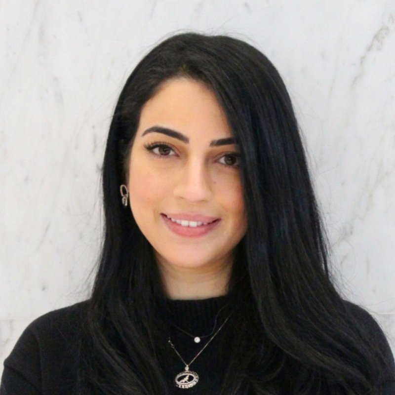

```{=html}
<div class="sb-read">

<section class="sb-about-head">
  <picture>
    <source srcset="assets/photo.webp" type="image/webp">
    
  </picture>
  <div>
    <h1>About me</h1>
    <p class="r">Engineer · Researcher · Writer · Lecturer</p>
    <p class="lang">Arabic · French · English</p>
  </div>
</section>

<section class="sb-story">
  <p><strong>Hi, I'm Sabrine.</strong> I'm an engineer in applied mathematics by training (Télécom Paris). For 10 years I've worked in innovation and R&amp;D teams, on the part of AI that most people skip: making something that works in a notebook work in the real world.</p>
  <p>I started in energy, then moved to water networks, where I contributed to a patent on leak prediction. Those years taught me that a model is only the beginning. The pipeline, the monitoring and the people who use it matter just as much.</p>
  <p>Then I wanted to point what I knew at <span class="hl">health</span>. I went back to study, with a Master's in computational neuroscience at CentraleSupélec, and moved into biosignals and medical imaging with AI startups. Today I build pipelines for multimodal brain imaging (MEG, functional MRI and structural MRI) that work for both sides: rigorous enough for research, robust enough for a product.</p>
  <p>Along the way I never stopped teaching. I've trained more than 500 people on DataILearn, the learning platform I built and ran, and I teach teams, bootcamp learners and university students. I write for Towards Data Science, and I share my courses here for free. I also help open the door for more women in tech, as a Google Women Techmakers Ambassador and president of the Descodeuses association.</p>
  <p>I speak Arabic, French and English, and I work in all three.</p>
</section>

<section style="margin-top:36px">
  <h2 class="sb-h2" style="font-size:26px">Path</h2>
  <div class="sb-path">
    <div>
      <span class="y">2016</span>
      <span class="w">Engineering degree in applied mathematics, Télécom Paris</span>
      <span class="d">The foundation.</span>
    </div>
    <div>
      <span class="y">2017 – 2022</span>
      <span class="w">AI R&amp;D, energy</span>
      <span class="d">Research projects taken to production.</span>
    </div>
    <div>
      <span class="y">2022 – 2023</span>
      <span class="w">AI R&amp;D, water networks</span>
      <span class="d">Leak prediction; contributor to a patent.</span>
    </div>
    <div>
      <span class="y">2024 – 2025</span>
      <span class="w">Biosignals &amp; medical imaging, AI startups</span>
      <span class="d">Pipelines between research and product.</span>
    </div>
    <div>
      <span class="y">2024 – 2025</span>
      <span class="w">Master's (M2) in Computational Neuroscience and Neuroengineering, Université Paris-Saclay / CentraleSupélec</span>
      <span class="d">The step towards health, alongside my work.</span>
    </div>
    <div class="now">
      <span class="y">Now · since 2025</span>
      <span class="w">Research engineer, health AI</span>
      <span class="d">Multimodal brain imaging: MEG, fMRI, structural MRI.</span>
    </div>
  </div>
</section>

<section class="sb-contact">
  <h2 class="sb-h2" style="font-size:26px">Get in touch</h2>
  <p>For training, talks or an AI project that needs to leave the lab.</p>
  <div class="sb-btns">
    <a class="sb-btn sb-btn-primary" href="work-with-me.html">Work with me</a>
    <a class="sb-btn" href="https://www.linkedin.com/in/sabrine-bendimerad-43570b107/">LinkedIn</a>
  </div>
</section>

</div>
```
